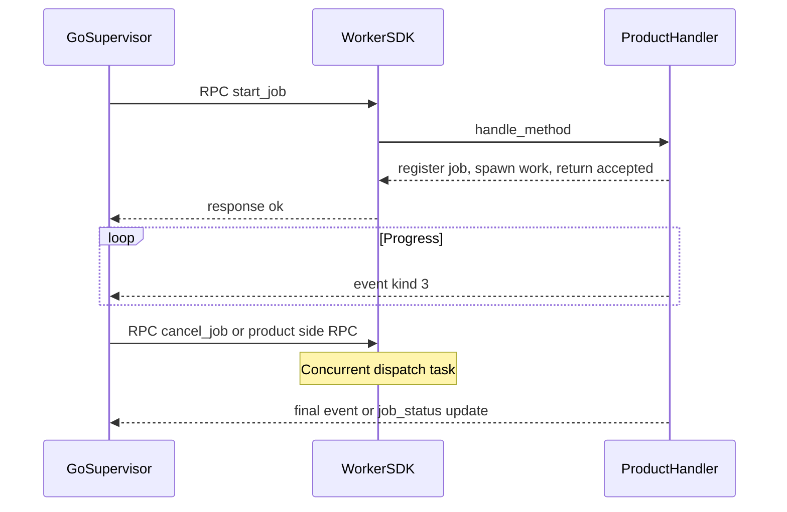

# Streaming and cooperative cancel (target)

| Field | Value |
|-------|-------|
| Status | Implemented |
| Phase | 3 |
| Plan | [2026-10-15-multi-language-foundation-plan.md](../plans/2026-10-15-multi-language-foundation-plan.md) |
| ADR | [0001-framework-boundary.md](../adr/0001-framework-boundary.md) |

> **Not implementation truth.** Events and `cancel_job` already exist; this spec documents the intended long-job pattern and Python helpers. Product event type strings are examples only.

## Goal

Make the recommended pattern for long-running product work explicit across Rust and Python SDKs: register a job, return the start RPC promptly, stream progress via kind-3 events, and accept concurrent side RPCs (`cancel_job`, product methods) on the same connection.

## Pattern (framework)

Rust already spawns one dispatch task per inbound request (`handle_connection` in `server.rs`), so `cancel_job` can run while a product job is in flight—provided the start handler does not block the worker forever without checking a cancel signal.

## Cooperative cancel

- Registry cancel (Rust oneshot / Python equivalent flag or event) is **cooperative**.
- Handlers that call blocking product APIs (for example Hermes `run_conversation`) may only observe cancel **after** that call returns. Document this limitation in SDK docs; do not pretend preemption exists.
- `cancel_job` still updates registry state when the job is known; runners should check the signal between units of work when possible.

## Streaming

- Use event frames (`type`, `job_id`, `payload`). Forge does **not** add builtins named `message.delta`, `tool.invoke`, etc.
- Products may use those strings in `type` / payload as **examples**. Advertise stream-related capability strings via `WorkerHandler.features` if useful; Forge only echoes them in `capabilities`.
- Optional later implementation work (not this docs pass): add a **generic** event-frame JSON fixture under `protocol/fixtures/` so codecs stay aligned; update `gen_spec` catalog notes.

## Python helpers (with Phase 1 SDK)

- Cancel flag or condition variable set by `JobRegistry.cancel`, mirrored to Rust’s oneshot semantics.
- Guidance: start RPC returns quickly; heavy work on a thread or async task; emit events from that task.

## Non-goals

- NDJSON turn protocol inside Forge.
- Reverse RPC (worker-initiated requests).
- Tool Router / allow-deny as control-plane methods.

## Acceptance checklist

- [ ] Cross-language doc section (Rust + Python) describing the pattern above.
- [ ] Python cancel helper parity with Rust registry cancel.
- [ ] Optional generic event fixture + contract coverage when codecs need it.
- [ ] Phase 3 marked Done in the foundation plan; implementation-spec notes only what actually shipped.

## Docs to update when Done

- [rust-worker.md](../rust-worker.md) and new python worker guide (when Phase 1 lands)
- [forge-implementation-spec.md](../forge-implementation-spec.md) if helpers become public API
- [protocol/spec.md](../../protocol/spec.md) if event fixtures are added
- Foundation plan phase table
